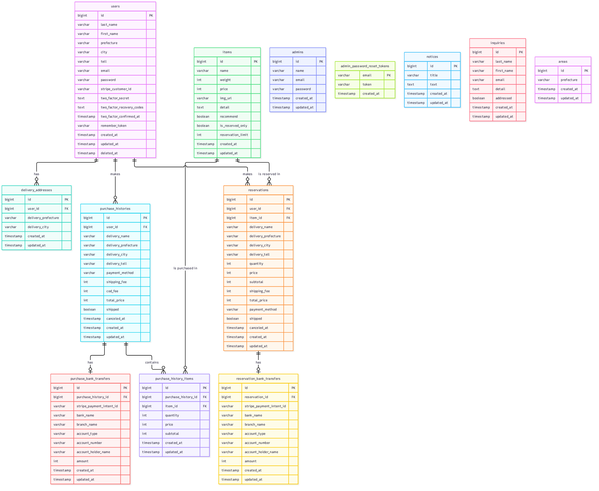
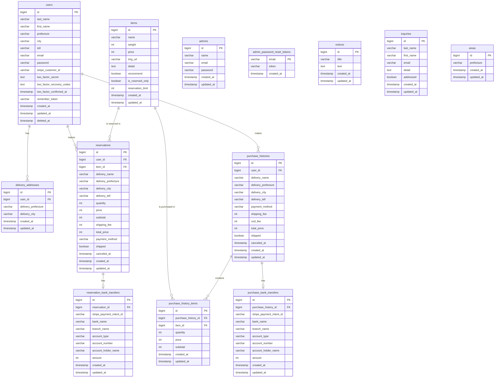

# ER図



## Mermaid版

このMermaid版が元の図で、上の画像（`images/er-diagram.png`）はここから生成したものです。カラムの詳細は [テーブル仕様書](05-table-specification.md) を参照してください。自分たちで作ったテーブルだけを載せ、Laravel 標準のテーブル（`password_reset_tokens`・`sessions`・`cache`・`jobs` など）は載せません。

テーブルを変えたときは、下のMermaidを直してから、画像を作り直します（mermaid-cli はプロジェクトには入れず、`npx` で一時的に使う。一時ファイルはリポジトリの外に置く）。画像の作り直し（`npx`）は、メインセッションが確認を経て行う。エージェントは Mermaid の修正までで止まり、画像の更新が必要だと報告する。

```bash
# docs/06-er-diagram.md の mermaid ブロックの中身（コードフェンスは除く）を /tmp/er.mmd に保存してから実行
echo '{"args":["--no-sandbox"]}' > /tmp/puppeteer.json
npx --yes @mermaid-js/mermaid-cli -i /tmp/er.mmd -o docs/images/er-diagram.png -b white -s 3 -p /tmp/puppeteer.json
```


